# Access Intelligence Center — Identity ER Diagram

The underlying data model AIC's Qlik dashboards and custom sheets are built against. This is a different (denormalized, reporting-oriented) shape than the live versioned REST resources — table/field names here are AIC's own naming, not the API's.

- Source: https://developer.sailpoint.com/docs/reporting/access-intelligence-center/identity-er-diagram (SailPoint developer docs, maintained on GitHub)

## Diagram

```mermaid
erDiagram
    IDENTITY ||--o{ IDENTITY_ATTRIBUTE : "associated to and owns"
    IDENTITY ||--o{ IDENTITY_ROLES_FULL : "associated to and owns"
    IDENTITY ||--o{ ACCESS_PROFILE : "associated to and owns"
    IDENTITY ||--o{ ACCOUNT : "associated to and owns"
    IDENTITY ||--o{ IDENTITY_APP : "associated to and owns"
    IDENTITY ||--o{ IDENTITY_ENTITLEMENTS_FULL : "associated to and owns"
    IDENTITY ||--o{ CERTIFICATION_ITEM : "associated to and owns"
    IDENTITY ||--o{ IDENTITY_REQUEST_ITEM : "associated to and owns"
    IDENTITY ||--o{ ACCESS_REQUEST_DURATION : "associated to and owns"
    ACCESS_PROFILE ||--o{ ACCESS_PROFILES_SOURCE : "associated to and owns"
    ACCOUNT ||--o{ ACCOUNT_SOURCE : "associated to and owns"
    IDENTITY_ENTITLEMENTS_FULL ||--o{ IDENTITY_ENTITLEMENT_SOURCE : "associated to and owns"
    CERTIFICATION_ITEM ||--o{ CERTIFICATION_STATS : "associated to and owns"
    CERTIFICATION_ITEM ||--o{ CERTIFICATION_ITEM_REVIEWER_IDENTITY : "associated to and owns"
    CERTIFICATION_ITEM ||--o{ CERTIFICATION : "associated to and owns"
    CERTIFICATION ||--o{ CERTIFICATION_CERTIFIER_IDENTITY : "associated to and owns"
    CERTIFICATION ||--o{ CERTIFICATION_SIGNER_IDENTITY : "associated to and owns"
    IDENTITY_REQUEST_ITEM ||--o{ ACCESS_REQUEST : "associated to and owns"
    IDENTITY_REQUEST_ITEM ||--o{ IDENTITY_ITEM_APPROVER : "associated to and owns"
    IDENTITY_REQUEST_ITEM ||--o{ IDENTITY_ITEM_REQUESTER : "associated to and owns"
    ACCESS_REQUEST ||--o{ ACCESS_REQUEST_TARGET_IDENTITY : "associated to and owns"
    ACCESS_REQUEST ||--o{ ACCESS_REQUEST_REQUESTER_IDENTITY : "associated to and owns"
```

`ACCESS_RELATIONSHIPS` (role/access-profile/entitlement name+ID join table) appears in the source diagram with no drawn relationship line — treat it as a lookup table joined implicitly on `ACCESS_RELATIONS_ROLE_ID` / `ACCESS_RELATIONS_AP_ID` / `ACCESS_RELATIONS_ENT_ID` when building sheets that need role/access-profile/entitlement display names together.

All `IDENTITY` relationships are **one-to-many**: one identity owns zero or more rows in each child table (multiple accounts, multiple entitlements, multiple certification items, etc.).

## Table reference

### IDENTITY — the root entity

| Field | Type | Notes |
|---|---|---|
| `TENANT_ID` | varchar | Customer org identifier |
| `IDENTITY_ID` | varchar | Primary key, referenced by nearly every other table |
| `IDENTITY_CREATED` / `IDENTITY_UPDATED` | timestamp | |
| `NAME` | varchar | |
| `DISPLAY_NAME` | varchar | Usually "First Last" |
| `MANAGERS_NAME` | varchar | |
| `EMAIL` | varchar | |
| `STATUS` | varchar | |
| `JOB_TITLE` | varchar | |
| `LOCATION` / `LOCATION_CODE` | varchar | |
| `DEPARTMENT` | varchar | |
| `IDENTITY_CREATED_MONTH_SORT` / `IDENTITY_CREATED_WEEK_SORT` | varchar / number | Sort keys for chart bucketing by creation month/week |
| `IDENTITY_SYNC_DATE` | timestamp | Last sync into AIC — this is the field that lags live ISC data by up to 24h |

### IDENTITY_ATTRIBUTE — extended identity attributes

`IDENTITY_ID`, `DisplayName`, `FirstName`, `LastName`, `IdentityState`, `Inactive` (boolean), `Country`, `Department`, `Email`, `PersonalEmail`, `IdentificationNumber`, `JobTitle`, `uid`, `Phone`, `WorkPhone`, `Location`, `StartDate`, `EndDate`.

> Source docs note this table is still being built out — no default-mapped values yet as of the source diagram's last update. Confirm actual population before building a sheet against it.

### Access — accounts, entitlements, roles, access profiles

| Table | Key fields | Purpose |
|---|---|---|
| `ACCOUNT` | `IDENTITY_ID`, `ACCOUNT_ID`, `NATIVE_IDENTITY`, `ACCOUNT_DISPLAY_NAME`, `ACCOUNT_SOURCE_ID`, `ACCOUNT_SOURCE_DISPLAY_NAME`, `ACCOUNT_SOURCE_TYPE`, `ACCOUNT_STATUS` | An identity's accounts across sources |
| `ACCOUNT_SOURCE` | `ACCOUNT_SOURCE_ID`, `ACCOUNT_SOURCE_CONNECTOR`, `ACCOUNT_SOURCE_DELETED_DATE`, `ACCOUNT_SOURCE_SYNC_DATE` | Source metadata joined off `ACCOUNT` |
| `IDENTITY_ENTITLEMENTS_FULL` | `IDENTITY_ID`, `ENTITLEMENT_ID`, `ENTITLEMENT_DISPLAY_NAME`, `ENTITLEMENT_ATTRIBUTE`, `ENTITLEMENT_VALUE`, `ENTITLEMENT_SOURCE_ID`, `ENTITLEMENT_TYPE`, `ENTITLEMENT_IS_REQUESTABLE`, created/updated/deleted/sync dates | An identity's entitlements |
| `IDENTITY_ENTITLEMENT_SOURCE` | `ENTITLEMENT_SOURCE_ID`, `ENTITLEMENT_SOURCE_TYPE`, `ENTITLEMENT_SOURCE_CONNECTOR`, deleted/sync dates | Source metadata joined off entitlements |
| `IDENTITY_ROLES_FULL` | `IDENTITY_ID`, `ROLE_ID`, `ROLE_NAME`, `ROLE_DISPLAY_NAME`, `ROLE_DESCRIPTION`, `ROLE_IS_ASSIGNABLE`, created/updated/deleted/sync dates | An identity's assigned roles |
| `ACCESS_PROFILE` | `IDENTITY_ID`, `ACCESS_PROFILE_ID`, `ACCESS_PROFILE_SOURCE_ID`, `ACCESS_PROFILE_NAME`, `ACCESS_PROFILE_DISPLAY_NAME`, `ACCESS_PROFILE_IS_ASSIGNABLE`, created/updated/deleted/sync dates | An identity's access profiles |
| `ACCESS_PROFILES_SOURCE` | `ACCESS_PROFILE_SOURCE_ID`, `ACCESS_PROFILE_SOURCE_DISPLAY_NAME`, `ACCESS_PROFILE_SOURCE_TYPE`, `ACCESS_PROFILE_SOURCE_CONNECTOR`, deleted/sync dates | Source metadata joined off access profiles |
| `IDENTITY_APP` | `IDENTITY_ID`, `APP_ID`, `APP_DISPLAY_NAME`, `APP_DESCRIPTION`, `APP_DELETED_DATE`, `APP_SYNC_DATE` | Apps associated to an identity |
| `ACCESS_RELATIONSHIPS` | `ACCESS_RELATIONS_ROLE_ID`/`_ROLE_NAME`, `ACCESS_RELATIONS_AP_ID`/`_ACCESS_PROFILE_NAME`, `ACCESS_RELATIONS_ENT_ID`/`_ENTITLEMENT_NAME` | Denormalized name/ID lookup spanning roles, access profiles, and entitlements — no drawn FK, join manually |

### Certifications

| Table | Key fields | Purpose |
|---|---|---|
| `CERTIFICATION_ITEM` | `CERTIFICATION_ID`, `REVIEWER_ID`, `IDENTITY_ID`, `CERTIFICATION_ITEM_ID`, `TYPE`/`SUB_TYPE`, `DECISION`, `APPROVED`/`REJECTED` (boolean), `REMEDIATED`, `PRIVILEGED`, `REMEDIATION_ACTION`, `MITIGATION_EXPIRATION`, `POLICY_NAME`, `CONSTRAINT_NAME`, created/updated/deleted/completed/decision/sync dates | The line-item decision within a certification (one identity/access combo reviewed) |
| `CERTIFICATION_STATS` | `CERTIFICATION_ID`, `CERTIFIER_DISPLAY_NAME`, `FINISHED_DATE`, `DUE_DATE`, `DAYS_LATE`, `HOURS_LATE` | SLA/lateness metrics per certification |
| `CERTIFICATION` | `CERTIFICATION_ID`, `CERTIFICATION_SIGNER_ID`, `CERTIFICATION_CERTIFIER_ID`, `CERTIFICATION_CAMPAIGN_ID`/`_STATUS`/`_DEADLINE`/`_NAME`/`_TYPE`, `COMPLETE`, `PHASE`, `IS_BULK_REASSIGNMENT`, `ELECTRONICALLY_SIGNED`, `PROCESS_REVOKES_IMMEDIATELY` | The parent certification/campaign record |
| `CERTIFICATION_ITEM_REVIEWER_IDENTITY` | `REVIEWER_ID` + identity fields (name, email, job title, location, department, etc.) | Denormalized identity profile of the reviewer |
| `CERTIFICATION_CERTIFIER_IDENTITY` | `CERTIFICATION_CERTIFIER_ID` + identity fields | Denormalized identity profile of the certifier |
| `CERTIFICATION_SIGNER_IDENTITY` | `CERTIFICATION_SIGNER_ID` + identity fields | Denormalized identity profile of the signer |

### Access requests

| Table | Key fields | Purpose |
|---|---|---|
| `IDENTITY_REQUEST_ITEM` | `IDENTITY_ID` (target), `IDENTITY_REQUEST_ITEM_ID`, approver/requester IDs, `_OPERATION`, `_PROVISIONING_STATE`, `_COMPILATION_STATUS`, `_EXECUTION_STATUS`, `_COMPLETION_STATUS`, `_RETRIES`, `_PROVISIONING_ENGINE`, entitlement/role fields (`_ENTITLEMENT_ID`, `_ROLE_ID`, etc.), `_ACCESS_REQUEST_ID` | Line-item within an access request (one grant/revoke action) — the AIC analogue of a `IdentityRequestItem` |
| `ACCESS_REQUEST` | `ACCESS_REQUEST_REQUESTER_ID`, `ACCESS_REQUEST_TARGET_ID`, `IDENTITY_REQUEST_ITEM_ACCESS_REQUEST_ID`, `ACCESS_REQUEST_NAME`, `_EXECUTION_STATUS`, `_COMPLETION_STATUS`, `_PRIORITY`, `_TYPE`, created/updated/deleted/end/sync dates | The parent access request |
| `ACCESS_REQUEST_DURATION` | `IDENTITY_ID`, `DURATION_HOURS` | Time from request creation to end date, per identity |
| `IDENTITY_ITEM_APPROVER` | `IDENTITY_REQUEST_ITEM_APPROVER_ID` + identity fields | Denormalized identity profile of the approver |
| `IDENTITY_ITEM_REQUESTER` | `IDENTITY_REQUEST_ITEM_REQUESTER_ID` + identity fields | Denormalized identity profile of the requester (item-level) |
| `ACCESS_REQUEST_REQUESTER_IDENTITY` | `ACCESS_REQUEST_REQUESTER_ID` + identity fields | Denormalized identity profile of the requester (request-level) |
| `ACCESS_REQUEST_TARGET_IDENTITY` | `ACCESS_REQUEST_TARGET_ID` + identity fields | Denormalized identity profile of the request target |

Each "+ identity fields" table repeats the same shape: `*_CREATED`, `*_UPDATED`, `*_NAME`, `*_DISPLAY_NAME`, `*_MANAGERS_NAME`, `*_EMAIL`, `*_STATUS`, `*_JOB_TITLE`, `*_LOCATION`, `*_LOCATION_CODE`, `*_DEPARTMENT`, `*_SYNC_DATE` — a flattened snapshot of an identity's profile at the time of the event, prefixed per role (reviewer/certifier/signer/approver/requester/target).

## Practical notes for building sheets

- Every table carries its own `*_SYNC_DATE` — use it (not the underlying event's own timestamp) if you need to reason about AIC's data freshness for that specific row.
- The `IDENTITY_REQUEST_ITEM` vs `ACCESS_REQUEST` split mirrors ISC's own request/item model: an `ACCESS_REQUEST` can contain multiple `IDENTITY_REQUEST_ITEM` rows (e.g. requesting 3 entitlements at once creates 1 request, 3 items). Join on `IDENTITY_REQUEST_ITEM_ACCESS_REQUEST_ID`.
- Denormalized "identity snapshot" tables (reviewer/certifier/signer/approver/requester/target) exist so a sheet doesn't have to join back to `IDENTITY` for every role in a certification or request — pick the pre-joined table for the role you need instead of chaining through `IDENTITY_ID`.
- `ACCOUNT_SOURCE`, `ACCESS_PROFILES_SOURCE`, and `IDENTITY_ENTITLEMENT_SOURCE` are separate tables per access type rather than one shared `SOURCE` table — don't assume a single source dimension covers accounts, access profiles, and entitlements together; join each to its matching table.
